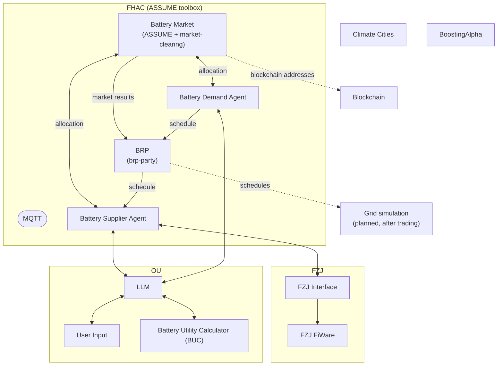
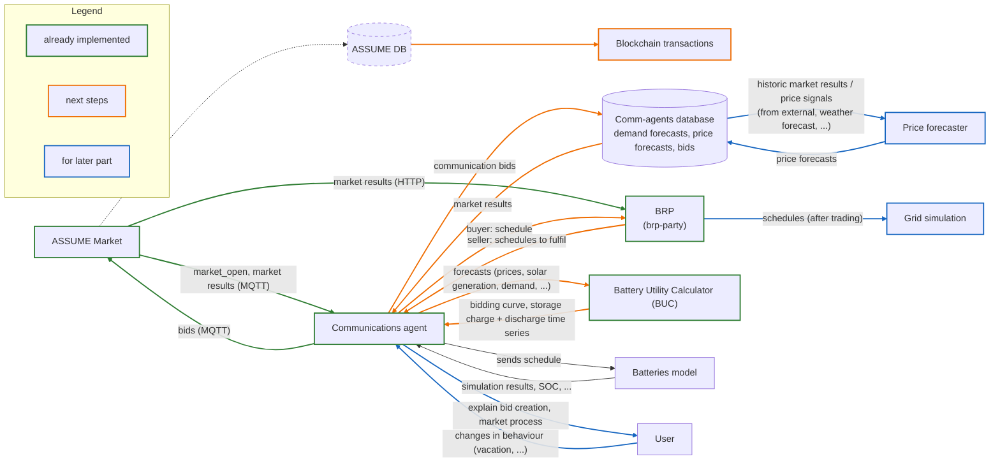

# MAS4TE project

This repository contains concepts and diagrams of the MAS4TE project.

## Overview

Components and responsibilities of the project partners. The schedules are exchanged via the BRP, see the [battery market flow](./seq_diagrams/battery_market.md).

## Schedule

| Workshop | Content |
|----------|---------|
| [1. July](./2025-07-01-workshop/README.md)  | Concepts & Programming  |

## Sequence Diagrams
[The battery market sequence diagram](./seq_diagrams/battery_market.md) shows the market process and the schedule handling via the BRP. The interface between ASSUME and the AI agents is described [here](./ai_agent.md).

## Product definitions
[See here](./virtual_products.md)

## Software stack and next steps
Green: already implemented, orange: next steps, blue: for a later part. ASSUME and the agents communicate via MQTT, see [AI agent](./ai_agent.md).

The state of the agent side (comm-agents database, BUC and BRP connection of the agents) is taken from February 2026; the code of the agents is not part of these repositories.

## Tools

- Git/GitHub for Version Control
- [Excalidraw](https://draw.nowum.fh-aachen.de/)
- [Diagrams.net](https://app.diagrams.net/)
- [Mermaid.js](https://mermaid.live/)
