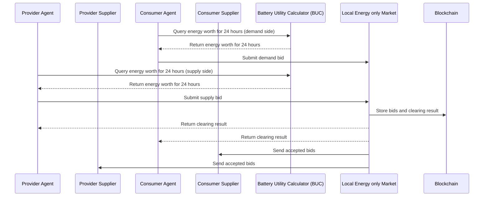

> **Status: planned, not implemented.** The local EOM (`CommunityEOM`) is commented out in
> `mas4te/simulation.py` of [MAS4TE/assume](https://github.com/MAS4TE/assume). The agents value
> the energy with the [Battery Utility Calculator (BUC)](https://github.com/NOWUM/battery-utility-calculator).

This diagram is only for the schedule of the energy only market (EOM). For the battery market process and its schedules please [see here](./battery_market.md).

