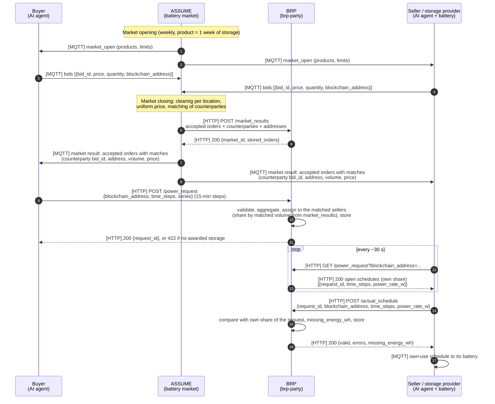

# Battery market flow

Market process and schedule handling of the battery market. For the (not yet implemented) energy only market see [here](./EOM_schedule.md).

Components:

- **ASSUME** ([MAS4TE/assume](https://github.com/MAS4TE/assume), branch `mas4te`): runs the weekly battery market. The clearing is [MAS4TE/market-clearing](https://github.com/MAS4TE/market-clearing).
- **BRP** ([MAS4TE/brp-party](https://github.com/MAS4TE/brp-party)): stores the market results, assigns the buyers' schedules to the matched sellers and validates the driven schedules.
- **AI agents** (buyer and seller): create the bids and talk to ASSUME via MQTT, see [AI agent](../ai_agent.md).

The blockchain address comes from the AI agent, the market in ASSUME reports the awarded
orders to the BRP, the BRP assigns the buyers' schedules to the matched sellers, the seller
(storage provider) polls its schedules from the BRP via HTTP.

## Authentication

- `POST /market_results`: HTTP Basic Auth, username `assume`, password `MARKET_RESULTS_PASSWORD` (only ASSUME).
- `POST /power_request`, `GET /power_request`, `POST /actual_schedule`: HTTP Basic Auth with `POWER_REQUEST_PASSWORD` (all agents).

## Not implemented yet

- The communications agent does not evaluate `matches` yet and does not send a
  `blockchain_address` with its bids (ASSUME skips bids without one).
- The `blockchain_address` in the BRP requests is not verified (no signature), so anyone
  with the `POWER_REQUEST_PASSWORD` can act as any buyer or seller.
- Bids and clearing results are not stored on a blockchain.
